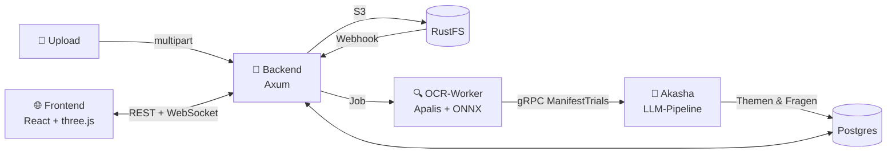

<div align="center">

# 💣 Team Claude's Plan

### *Keep Learning and Nobody Explodes*

**Lade deine Lernunterlagen hoch. Die KI baut daraus eine Bombe. Entschärft sie zu zweit.**

[](https://github.com/Team-Claudes-Plan/keep-learning-and-nobody-explodes)
[](https://github.com/Team-Claudes-Plan/keep-learning-and-nobody-explodes/tree/main/frontend)
[](https://github.com/Team-Claudes-Plan/keep-learning-and-nobody-explodes/blob/main/flake.nix)
[](https://github.com/Team-Claudes-Plan/keep-learning-and-nobody-explodes/tree/main/frontend/src/ar)
[](#-das-team)

</div>

---

## 🧠 Die Idee

Lernen allein ist langweilig. Lernen unter Zeitdruck, mit einer tickenden Bombe und einem Partner, der dir nur sagen kann, *welches Symbol* du drücken musst? Das ist **Keep Learning and Nobody Explodes**.

Inspiriert von *Keep Talking and Nobody Explodes*, nur dass die Bombe aus **deinem eigenen Lernstoff** besteht:

1. 📄 **Hochladen:** Skripte, Folien oder abfotografierte Notizen landen auf deiner **Insel**.
2. 🤖 **Verwandeln:** Unsere KI-Pipeline **Akasha** liest den Text (OCR), findet Themen und generiert daraus Fragen.
3. 🏙️ **Bauen:** Jedes Thema wird ein **Haus** auf deiner schwebenden Low-Poly-Insel. Je mehr du weißt, desto höher wächst es.
4. 💣 **Entschärfen:** Zwei Spieler, eine Bombe, fünf Minuten, drei Fehler. Los.

## 🎮 So wird gespielt

| 🔧 **Defuser** | 📖 **Expert** |
|---|---|
| Sieht das Bombenmodul, aber **nicht die Frage** | Sieht die Frage und das **Handbuch** |
| Die Antworten erscheinen als **abstrakte Symbole** | Weiß, welches Symbol für welche Antwort steht |
| Muss die Antwort eingeben | Muss die Symbole beschreiben, ohne sie zu sehen |

➡️ **Ihr müsst miteinander reden.** Nach jedem Modul werden die Rollen getauscht, damit beide den Stoff lernen.

- ⏱️ Standardmäßig 5 Minuten Timer, 3 Strikes und du bist raus
- 🧩 9 Fragetypen: Single/Multiple Choice, Wahr/Falsch, Text, Zahl, Zuordnen, Gruppieren, Sortieren und Koordinaten
- 🔣 Kein Symbol kommt zweimal in einem Spiel vor
- 🏝️ Häuser wachsen nur so weit, wie **beide** Inselbewohner das Thema beherrschen
- 🍴 Lernen mit einer dritten Person? **Forke die Insel.** Die Häuser werden geteilt, der Fortschritt bleibt pro Paar

## 📱 Bonus: Die Bombe in AR

Unter `/ar-demo` steht die Bombe **in deinem Wohnzimmer**. Sie wird mit 8th Wall auf den Boden gestellt, du kannst sie drehen und zoomen und auf ein Modul tippen: Dann fliegt es vor die Kamera und das Minispiel öffnet sich. Es gibt sechs Lernlevel von *Foundations* bis *Analysis*, dazu Kabel, Sicherungen, Drehschalter, Terminal, Radar, Schloss und mehr.

Das 3D-Modell der Bombe haben wir selbst in Blender gebaut.

## 🏗️ Architektur



- **`backend/`**: Rust/Axum-Server mit Upload, Webhook, OCR-Worker und der JSON/WebSocket-API
- **`akasha/`**: gRPC-Service, der per LLM (OpenAI-kompatible API) aus OCR-Text Themen, Fragen und Handbuchseiten generiert
- **`frontend/`**: React 19, Vite und React Three Fiber für die isometrische Insel, die 2.5D-Häuser, das Bomben-Gameplay und die AR-Demo
- **`schema/`**: JSON-Schemas für Fragen, Antworten und das Session-Protokoll
- **Event Sourcing:** Jedes Spiel ist ein lückenloses Event-Log in Postgres. Der Server ist die Autorität, und Spiele überstehen sogar einen Neustart.

## 🚀 Loslegen

```bash
git clone https://github.com/Team-Claudes-Plan/keep-learning-and-nobody-explodes.git
cd keep-learning-and-nobody-explodes

# Backend-Stack: Postgres, RustFS, Webhooks, Backend mit cargo watch
nix run .#dev

# Frontend (in einem zweiten Terminal)
cd frontend
bun install
bun run dev
```

Für AR auf dem Handy wird HTTPS gebraucht: `bun run cert` erzeugt ein lokales Entwicklungszertifikat.

## 📦 Repositories

| Repo | Inhalt |
|---|---|
| [**keep-learning-and-nobody-explodes**](https://github.com/Team-Claudes-Plan/keep-learning-and-nobody-explodes) | Das Spiel: Backend, Akasha und Frontend |
| [**.github**](https://github.com/Team-Claudes-Plan/.github) | Dieses Profil |

## 👥 Das Team

<table>
  <tr>
    <td align="center"><a href="https://github.com/IchBinLeoon"><br/><sub><b>Leon Bohnwagner</b></sub></a></td>
    <td align="center"><a href="https://github.com/xamtodd"><br/><sub><b>Max Gerbeth</b></sub></a></td>
    <td align="center"><a href="https://github.com/JonasGoebel"><br/><sub><b>Jonas Göbel</b></sub></a></td>
    <td align="center"><a href="https://github.com/Lachstec"><br/><sub><b>Leon Lux</b></sub></a></td>
  </tr>
  <tr>
    <td align="center"><a href="https://github.com/demondave"><br/><sub><b>David Maul</b></sub></a></td>
    <td align="center"><a href="https://github.com/bytedream"><br/><sub><b>Ruben Otto</b></sub></a></td>
    <td align="center"><a href="https://github.com/binsky08"><br/><sub><b>Timo Triebensky</b></sub></a></td>
    <td align="center"><a href="https://github.com/PhilVoel"><br/><sub><b>Philipp Völler</b></sub></a></td>
  </tr>
</table>

<div align="center">

---

*Gebaut mit zu viel Kaffee, zu wenig Schlaf und einer Bombe, die bisher noch niemanden verletzt hat.* 💥

</div>
# .github
